# MemDeck - Ứng dụng học ngoại ngữ bằng Flashcard cho KOReader
# MemDeck - Flashcard Language Learning App for KOReader

  <b>Học từ vựng trên máy đọc sách e-ink: Flashcard SM-2 · 7 kiểu kiểm tra · Gia sư AI · Kho bộ thẻ 10 ngôn ngữ</b> 
  <i>Learn vocabulary on your e-ink reader: SM-2 flashcards · 7 test types · AI tutor · Deck store in 10 languages</i>

## 🎨 Giao diện chính / Main Interface

  <table>
    <tr>
      <td>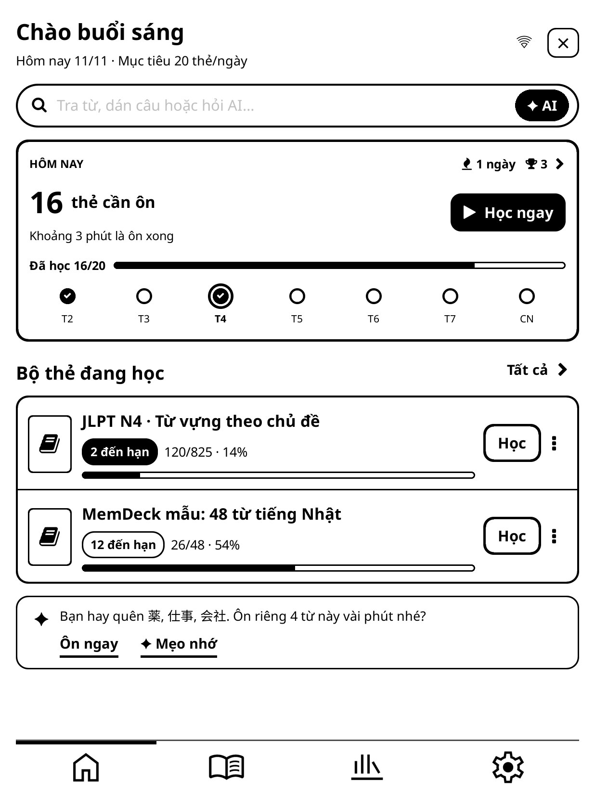</td>
      <td>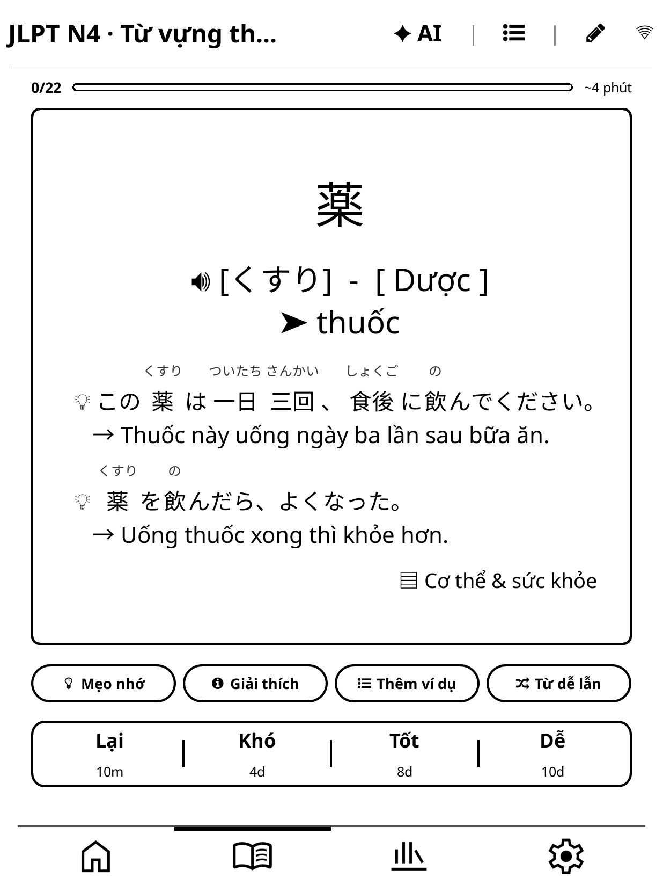</td>
      <td>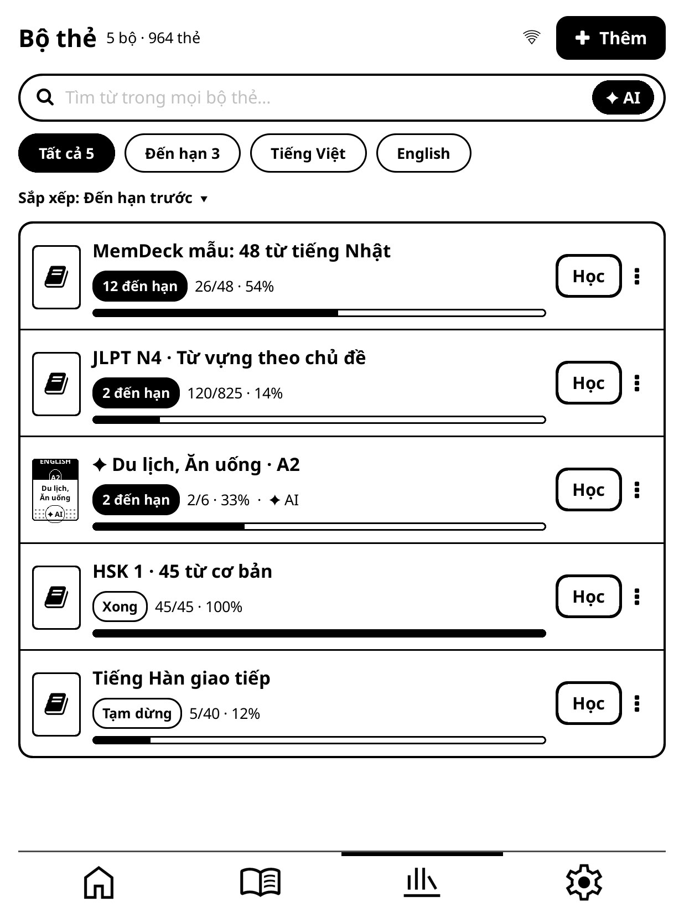</td>
      <td>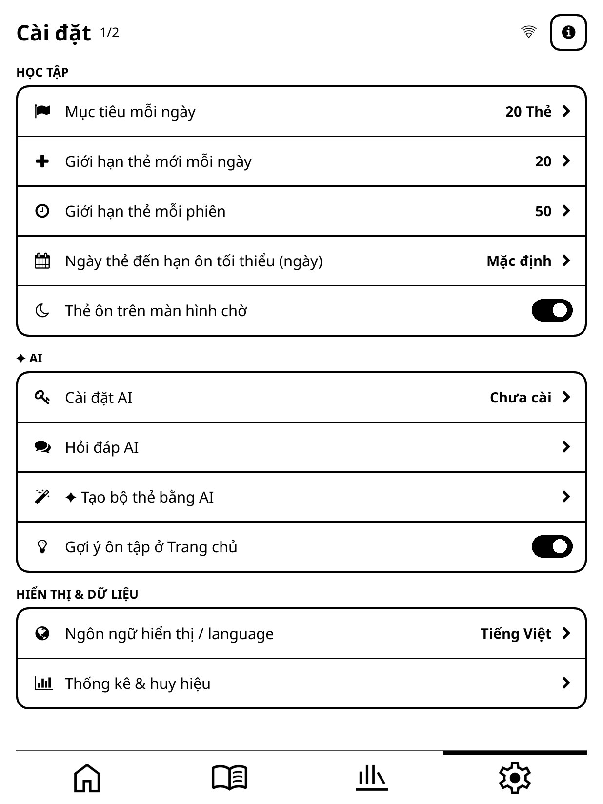</td>
    </tr>
    <tr>
      <td align="center"><b>🏠 Trang chủ</b> Home</td>
      <td align="center"><b>📖 Học</b> Study</td>
      <td align="center"><b>📚 Thư viện</b> Library</td>
      <td align="center"><b>⚙️ Cài đặt</b> Settings</td>
    </tr>
  </table>

---

## 📖 Giới thiệu / Introduction

**MemDeck** là plugin học ngoại ngữ dành cho **KOReader** (nền tảng đọc sách trên các thiết bị e-ink như Kindle, Kobo, PocketBook, Android...). Ứng dụng giúp bạn học từ vựng hiệu quả bằng flashcard kết hợp lặp lại ngắt quãng (SM-2), nhiều kiểu kiểm tra và một gia sư AI ngay trên máy đọc sách.

**MemDeck** is a language learning plugin for **KOReader** (an e-ink reading platform for Kindle, Kobo, PocketBook, Android...). It helps you learn vocabulary with flashcards and spaced repetition (SM-2), many test types and an AI tutor right on your e-reader.

---

## ✨ Tính năng chính / Key Features

### 🏠 Trang chủ gọn, biết hôm nay cần học gì / A focused Home screen

<table>
  <tr>
    <td width="200"></td>
    <td>

| Tiếng Việt | English |
|------------|---------|
| Thẻ «Hôm nay»: số thẻ cần ôn, thời gian dự kiến, nút **Học ngay** | «Today» card: cards due, estimated time, **Study now** button |
| Mục tiêu ngày và chuỗi ngày học (streak) theo tuần | Daily goal and weekly study streak |
| Ô tra cứu: tra từ trong mọi bộ thẻ hoặc hỏi AI | Search box: look up words in all decks or ask AI |
| Danh sách bộ thẻ đang học, mỗi bộ một nút **Học** | Decks in progress, each with a **Study** button |
| Gợi ý ôn các từ hay quên | Tips to review the words you often forget |

</td>
  </tr>
</table>

### 🎯 Học flashcard thông minh / Smart flashcards

  <table>
    <tr>
      <td>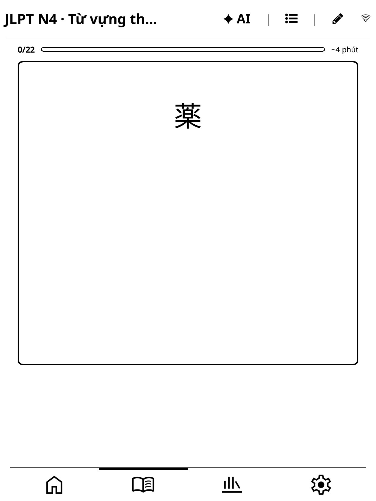</td>
      <td></td>
      <td>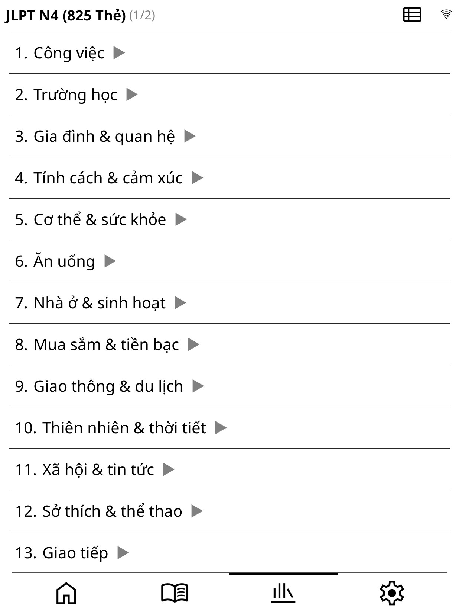</td>
    </tr>
    <tr>
      <td align="center"><b>Mặt trước</b> Front</td>
      <td align="center"><b>Mặt sau + gợi ý AI</b> Back + AI chips</td>
      <td align="center"><b>Danh sách thẻ theo chủ đề</b> Cards by topic</td>
    </tr>
  </table>

| Tiếng Việt | English |
|------------|---------|
| Lặp lại ngắt quãng SM-2: 4 mức Lại / Khó / Tốt / Dễ, hiện sẵn thời gian ôn lại | SM-2 spaced repetition: Again / Hard / Good / Easy with next-review times |
| Chạm vào thẻ để lật, thanh tiến trình cho mỗi lượt học | Tap the card to flip, progress bar for every session |
| Mặt sau: cách đọc, âm Hán Việt, loại từ, nghĩa và 2 câu ví dụ có dịch | Back side: reading, Sino-Vietnamese, part of speech, meaning and 2 translated examples |
| Phiên âm furigana / pinyin nằm trên chữ Hán trong câu ví dụ | Furigana / pinyin shown above Kanji/Hanzi in example sentences |
| 4 nút AI ngay dưới thẻ: Mẹo nhớ, Giải thích, Thêm ví dụ, Từ dễ lẫn | 4 AI buttons under the card: Mnemonic, Explain, More examples, Confusable words |
| Thẻ ôn trên màn hình chờ khi máy ngủ | Review card on the sleep screen |

### 📝 7 kiểu kiểm tra / 7 test types

  <table>
    <tr>
      <td>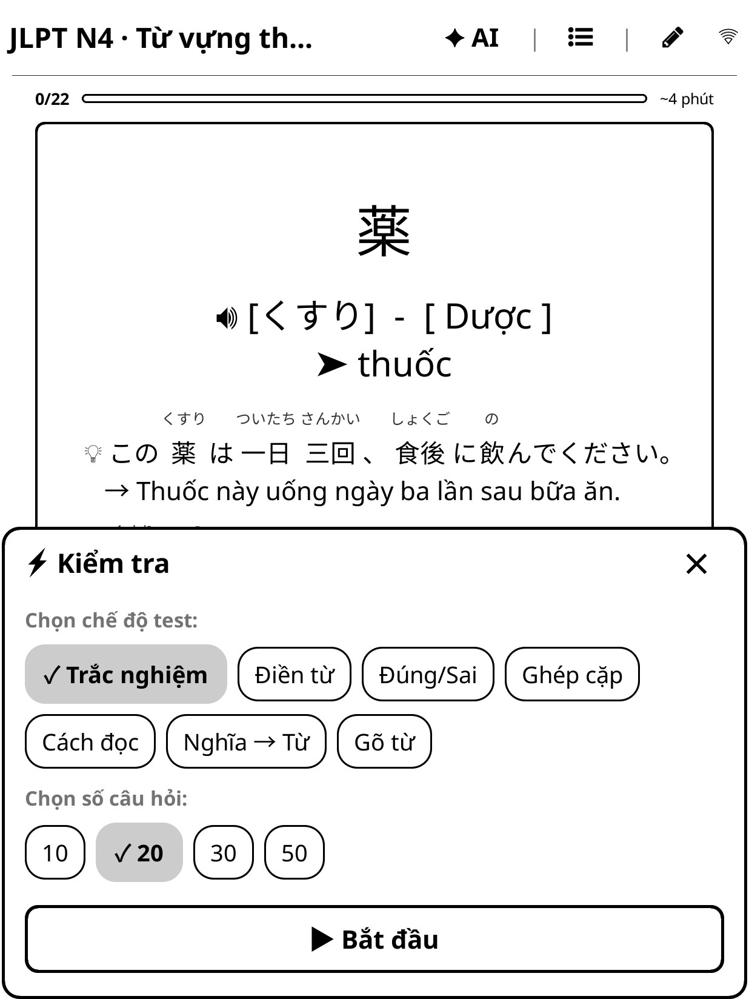</td>
      <td>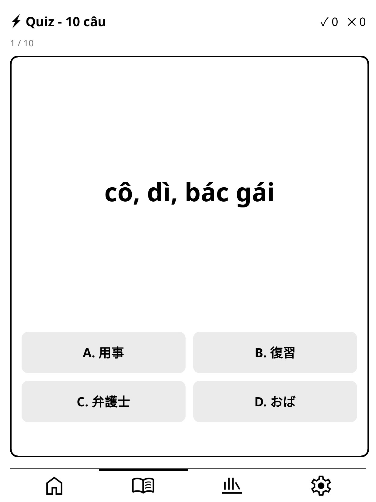</td>
      <td>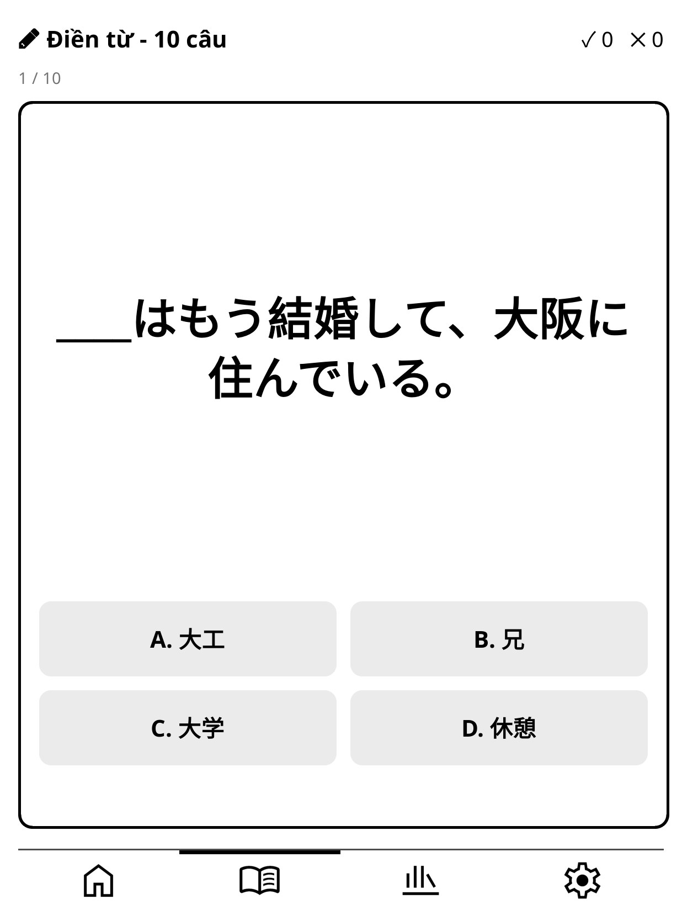</td>
      <td>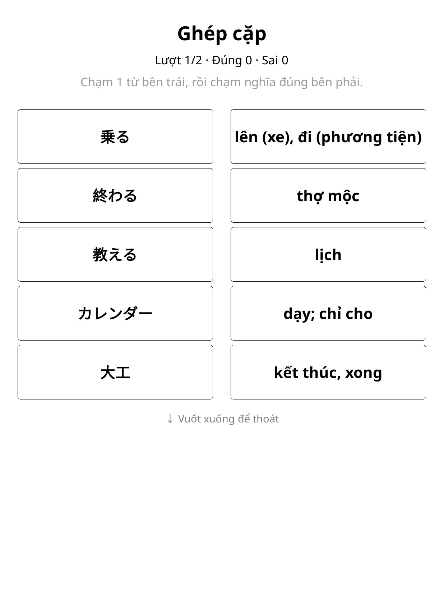</td>
    </tr>
    <tr>
      <td align="center"><b>Chọn kiểu test</b> Test menu</td>
      <td align="center"><b>Trắc nghiệm</b> Quiz</td>
      <td align="center"><b>Điền từ</b> Cloze</td>
      <td align="center"><b>Ghép cặp</b> Matching</td>
    </tr>
  </table>

| Tiếng Việt | English |
|------------|---------|
| Trắc nghiệm: chọn từ đúng với nghĩa | Quiz: pick the word that matches the meaning |
| Điền từ: điền từ còn thiếu vào câu ví dụ | Cloze: fill in the missing word in a sentence |
| Đúng / Sai, Ghép cặp từ – nghĩa | True / False, Match words with meanings |
| Cách đọc, Nghĩa → Từ, Gõ từ | Reading, Meaning → Word, Type the word |
| Chọn 10 / 20 / 30 / 50 câu, kết quả cộng vào XP | Choose 10 / 20 / 30 / 50 questions, results add to XP |

### ✦ Gia sư AI (Google Gemini) / AI tutor (Google Gemini)

  <table>
    <tr>
      <td>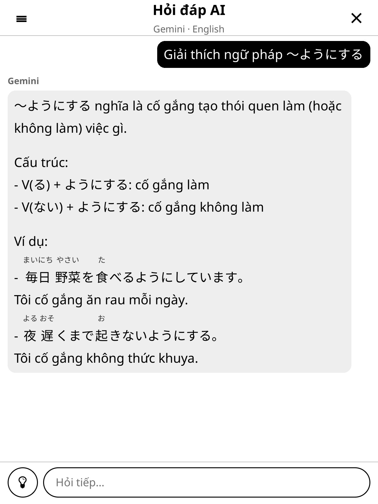</td>
      <td>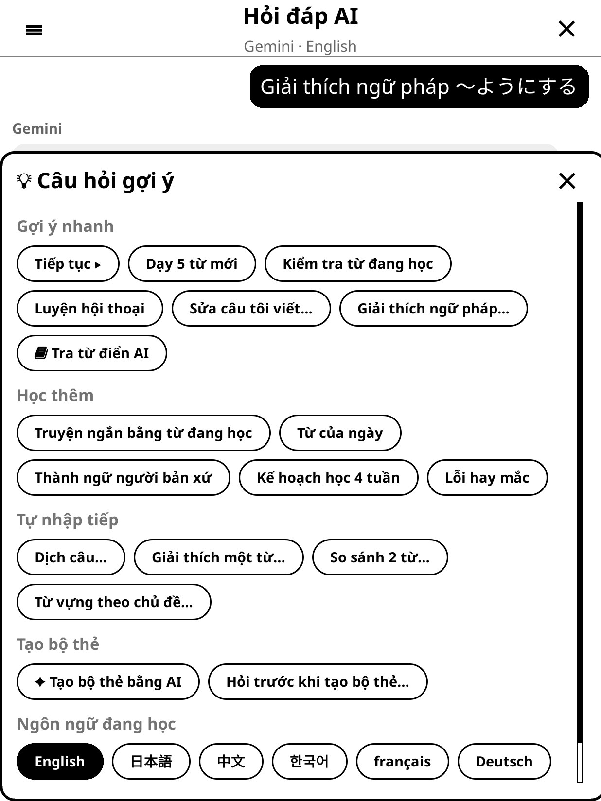</td>
      <td>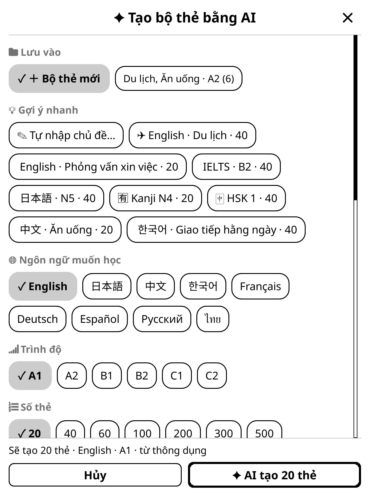</td>
      <td>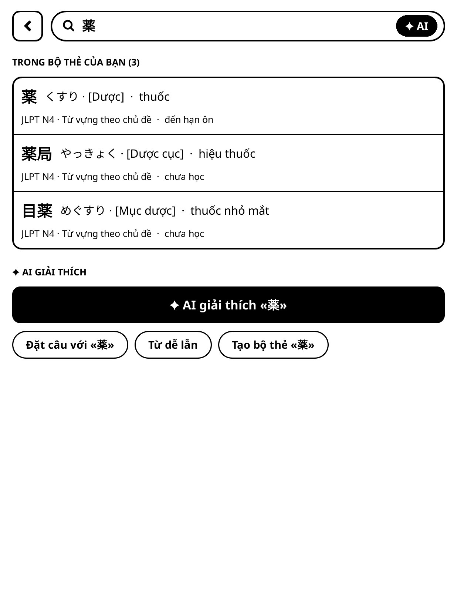</td>
    </tr>
    <tr>
      <td align="center"><b>Hỏi đáp AI</b> AI chat</td>
      <td align="center"><b>Câu hỏi gợi ý</b> Suggested prompts</td>
      <td align="center"><b>Tạo bộ thẻ bằng AI</b> AI deck builder</td>
      <td align="center"><b>Tra cứu</b> Lookup</td>
    </tr>
  </table>

| Tiếng Việt | English |
|------------|---------|
| Hỏi đáp AI theo ngôn ngữ và trình độ của bạn, trả lời bằng ngôn ngữ giao diện | AI chat tuned to your target language and level, answers in your UI language |
| Câu hỏi gợi ý bấm một chạm: dạy 5 từ mới, kiểm tra từ đang học, luyện hội thoại, sửa câu, giải thích ngữ pháp, truyện ngắn bằng từ đang học... | One-tap prompts: 5 new words, quiz my words, conversation practice, fix my sentence, explain grammar, short story with my words... |
| Tạo bộ thẻ bằng AI: chọn ngôn ngữ, trình độ, chủ đề và số thẻ (20 → 500) | AI deck builder: choose language, level, topic and size (20 → 500 cards) |
| Từ điển AI và tra cứu từ trong mọi bộ thẻ đã có | AI dictionary and search across all your decks |
| Dùng key Gemini miễn phí của bạn; nhập key bằng cách quét mã QR từ điện thoại | Uses your own free Gemini key; send it from your phone by scanning a QR code |

### ☁ Kho bộ thẻ online / Online Deck Store

  <table>
    <tr>
      <td>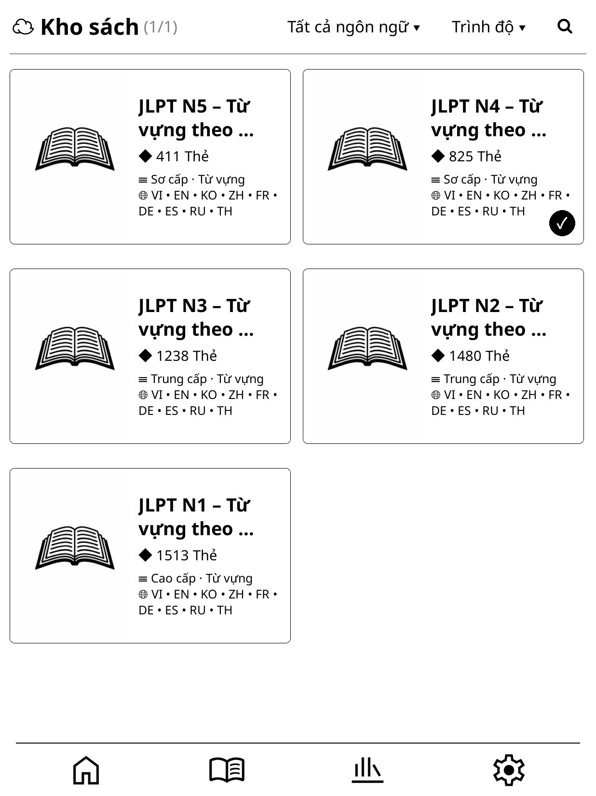</td>
      <td>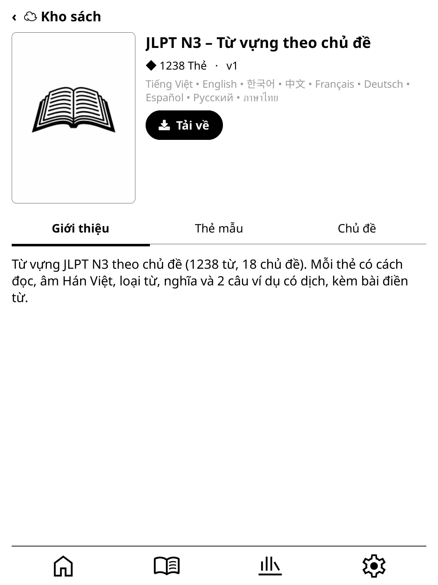</td>
      <td></td>
    </tr>
    <tr>
      <td align="center"><b>Kho sách</b> Store</td>
      <td align="center"><b>Chi tiết bộ thẻ</b> Deck details</td>
      <td align="center"><b>Thư viện</b> Library</td>
    </tr>
  </table>

| Tiếng Việt | English |
|------------|---------|
| Bộ thẻ JLPT N5 → N1, HSK, tiếng Anh, tiếng Hàn..., lọc theo ngôn ngữ, trình độ, thể loại | JLPT N5 → N1, HSK, English, Korean... decks, filter by language, level and category |
| Chọn ngôn ngữ nghĩa khi tải: Việt, Anh, Hàn, Trung, Pháp, Đức, Tây Ban Nha, Nga, Thái | Choose the meaning language: Vietnamese, English, Korean, Chinese, French, German, Spanish, Russian, Thai |
| Xem giới thiệu, thẻ mẫu và danh sách chủ đề trước khi tải | Preview description, sample cards and topics before downloading |
| Bộ thẻ đã tải có dấu ✓, tự báo khi có bản cập nhật | Downloaded decks are marked ✓, with update notices |
| Tải chạy nền, vẫn học được trong lúc tải | Downloads run in the background while you keep studying |

### 📚 Quản lý bộ thẻ / Deck management

| Tiếng Việt | English |
|------------|---------|
| Thư viện: tìm trong mọi thẻ, lọc theo trạng thái / ngôn ngữ, sắp xếp theo hạn ôn | Library: search all cards, filter by status / language, sort by due date |
| Nhập bộ thẻ từ CSV và Anki (.apkg), AI điền các ô còn trống | Import decks from CSV and Anki (.apkg), AI fills empty fields |
| Gửi file từ điện thoại / máy tính qua Wi-Fi (quét mã QR) | Send files from phone / computer over Wi-Fi (scan a QR code) |
| Tạo thẻ từ sách đang đọc trong KOReader | Create cards from the book you are reading in KOReader |
| Tạm dừng / học tiếp, ưu tiên chủ đề, sao lưu và khôi phục | Pause / resume, topic priority, backup and restore |

### 📊 Thống kê / Statistics

<table>
  <tr>
    <td width="200">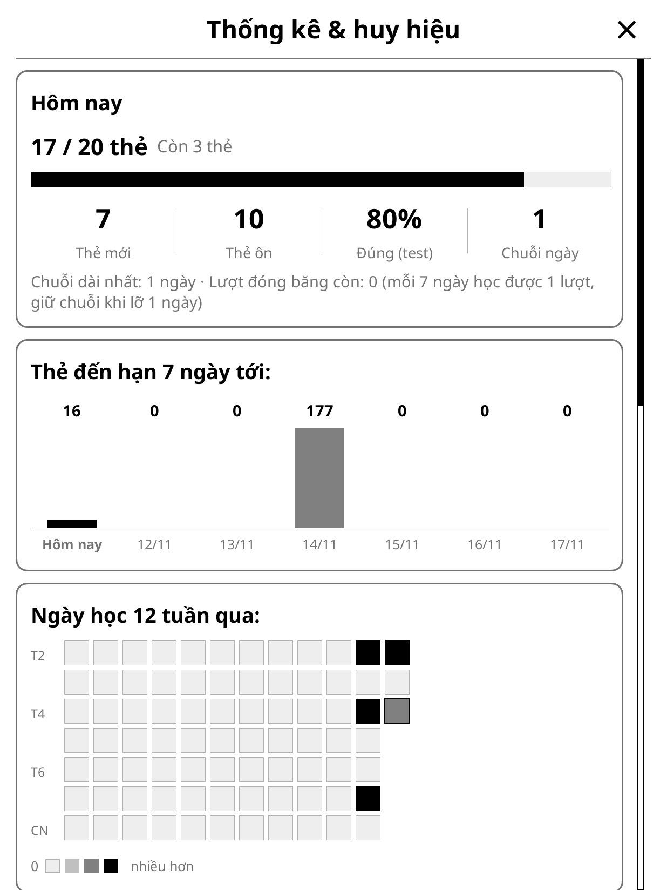</td>
    <td>

| Tiếng Việt | English |
|------------|---------|
| Thẻ học hôm nay so với mục tiêu, chuỗi ngày học | Today's cards vs. goal, study streak |
| Biểu đồ thẻ đến hạn 7 ngày tới | Cards due over the next 7 days |
| Lịch học 12 tuần qua | 12-week study calendar |
| XP từ thẻ mới, thẻ ôn và kết quả test | XP from new cards, reviews and test results |

</td>
  </tr>
</table>

### 🎨 Tối ưu cho e-ink / Built for e-ink

| Tiếng Việt | English |
|------------|---------|
| Giao diện trắng đen tương phản cao, ít làm mới màn hình | High-contrast black & white UI with minimal screen refresh |
| Tự co giãn theo màn hình: từ 6" 600×800 đến điện thoại Android | Adapts from 6" 600×800 screens up to Android phones |
| Hỗ trợ cảm ứng và phím lật trang | Touch and page-turn button support |
| Thanh dưới 4 tab: Trang chủ, Học, Thư viện, Cài đặt | Bottom bar with 4 tabs: Home, Study, Library, Settings |
| Giao diện 10 ngôn ngữ: VI, EN, JA, KO, ZH, FR, DE, ES, RU, TH | UI in 10 languages: VI, EN, JA, KO, ZH, FR, DE, ES, RU, TH |

---

## 📦 Yêu cầu hệ thống / Requirements

| Thành phần / Component | Yêu cầu / Requirement |
|------------------------|------------------------|
| **KOReader** | Phiên bản 2024.01 trở lên / Version 2024.01 or higher |
| **Thiết bị / Device** | Kindle, Kobo, PocketBook, Android với KOReader / with KOReader |
| **Dung lượng / Storage** | ~10MB + dữ liệu bộ thẻ / + deck data |
| **AI (tuỳ chọn / optional)** | Key Google Gemini miễn phí + Wi-Fi / Free Google Gemini key + Wi-Fi |
| **Ngôn ngữ / Languages** | VI, EN, JA, KO, ZH, FR, DE, ES, RU, TH |

---

## 🚀 Cách cài đặt / Installation

Vui lòng truy cập Website: https://doc-online.io.vn để tải plugin và xem hướng dẫn chi tiết.

Please visit Website: https://doc-online.io.vn to download the plugin and see detailed instructions.

---

## 📞 Liên hệ / Contact

| Tiếng Việt | English |
|------------|---------|
| **Website** | https://doc-online.io.vn |
| **Email** | support@doc-online.io.vn |
| **GitHub** | https://github.com/doconline2026-cell/memdeck |
